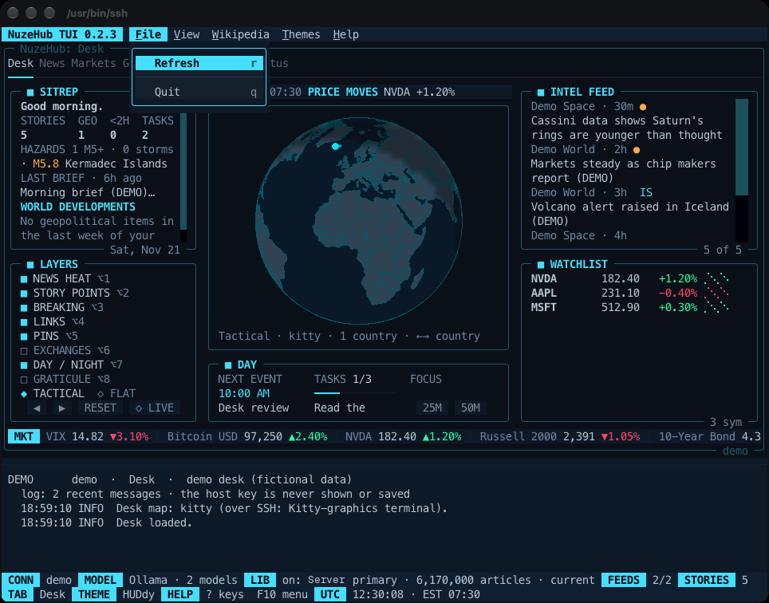
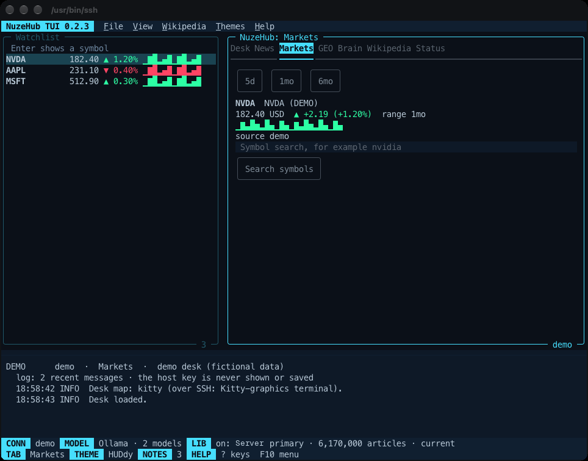

# NuzeHub TUI

A keyboard-first terminal client of the NuzeHub desk. It calls the same server functions as the web app (no second backend) and has the SSHush look: menu bar, rounded panes, compact role-coloured buttons, an activity panel and a 2-row status bar.

0.2.0 adds the Desk (the web desk's OPS layout) and makes HUDdy the default theme (23 themes, GitHub Dark second). 0.2.1 adds Live Mode. 0.2.2 splits it into Globe Spin, Stock Ticker and Auto-Updates with speed presets. **0.2.3** softens HUDdy (background `#080e19`, body text `#c2cfdc`; no hue change) and draws selected items as dark text on the accent in every dark theme.





## Features

- **Desk** — SITREP, map layers, alerts, Day dock, intel feed, watchlist and the market tape, matching the web OPS desk.
- **News, Markets, GEO, Brain, Wikipedia Library, Status** — the same server data as the web app.
- **Live Mode** — Globe Spin, Stock Ticker and Auto-Updates, each on its own, with Eco / Smooth / Ultra speeds.
- **Wikipedia** — search the local library, cite into a note, save to Brain, with undo.
- **23 themes**, HUDdy default; selected rows use dark text on the accent.
- **Truecolor over ssh**, including Ghostty, without you having to forward `COLORTERM`.
- **Demo mode** (`--demo`) runs a fictional desk with no network.
- **Ollama first** for the model chip; LM Studio appears only as a fallback when Ollama does not answer, and is never treated as an error when it is absent.

## Requirements

- macOS is the intended platform (the TUI also runs wherever Python and a modern terminal do).
- Python **3.11, 3.12 or 3.13**. The recommended interpreter is Homebrew's `python@3.13`.
- A running NuzeHub desk to connect to (not required for `--demo`).
- [Ghostty](https://ghostty.org) is recommended for Kitty-graphics maps and exact HUDdy colours. Kitty also works; other terminals fall back to Braille or text.
- [Homebrew](https://brew.sh) and `pipx`.
- Ollama is the default local model; LM Studio is optional.

```zsh
brew install python@3.13 pipx
pipx ensurepath          # then open a new terminal
```

## Install

From a release wheel, the sdist, or this repository:

```zsh
pipx install --python python3.13 ./nuzehub_tui-0.2.3-py3-none-any.whl
# or: pipx install --python python3.13 ./nuzehub_tui-0.2.3.tar.gz
# or: pipx install --python python3.13 "git+https://github.com/davidprush/nuzehub-tui@v0.2.3"
# or, from a checkout:
pipx install --python python3.13 .
nuzehub-tui --version                    # expect: 0.2.3
```

Upgrade with `pipx install --force` (it ignores `--python`; re-check the interpreter in the pipx venv, and run `pipx reinstall --python python3.13 nuzehub-tui` if it is not 3.11–3.13).

A local-install helper is in [`scripts/install.sh`](scripts/install.sh).

### Connecting from another Mac

On the machine that runs the NuzeHub desk, the TUI talks to `http://127.0.0.1:8080` by default. From another Mac, run the TUI *on the server* over ssh rather than pointing it at a remote URL (the desk listen address is unchanged).

[`scripts/install-remote-launcher.sh`](scripts/install-remote-launcher.sh) writes `~/.local/bin/nuzehub-remote`:

```zsh
export NUZEHUB_SSH_HOST=nuzehub-server    # ssh Host name or alias from your ~/.ssh/config
./scripts/install-remote-launcher.sh
nuzehub-remote                            # ssh -t "$NUZEHUB_SSH_HOST" '$HOME/.local/bin/nuzehub-tui'
```

If no `NUZEHUB_SSH_HOST` is set, the script uses `nuzehub-server`. Put a matching `Host` entry in `~/.ssh/config`. A remote (non-loopback, untrusted) session shows the key gate; the key is held in memory for the session and never shown, logged or saved. `?key=` links are refused.

## Quick start

```zsh
nuzehub-tui                 # http://127.0.0.1:8080
nuzehub-tui --check         # connection, library, model and /api/model-status; no secrets; no TUI
nuzehub-tui --demo          # fictional desk, no network
nuzehub-tui --url URL       # or NUZEHUB_TUI_URL
```

## Usage and keybindings

Tabs: **0** Desk (the start tab) · **1** News · **2** Markets · **3** GEO list · **4** Brain · **5** Wikipedia · **6** Status.

F10 (or Alt+letter with `macos-option-as-alt = true` in Ghostty) opens the menus: File, View, Wikipedia, Themes, Help.

| Key | Action |
| --- | --- |
| `r` | Refresh |
| `L` | Live Mode (all) |
| `G` / `K` / `U` | Globe Spin / Stock Ticker / Auto-Updates |
| `S` | Live Speed |
| `I` | Auto-Update interval |
| `t` / `T` | Next theme / theme list |
| `b` | List pane |
| `A` | Activity panel |
| `?` | Help |
| `/` | Wikipedia search |
| `c` | Cite (Wikipedia) / filter Intel to a country (Desk) |
| `s` | Save to Brain |
| `u` | Undo |
| `Esc` | Back / close |
| `q` | Quit (never from a dialog) |

### Desk

SITREP (tiles, hazards, last brief, world developments) and LAYERS on the left; ALERTS, the map and the Day dock (next event, tasks, Focus 25m/50m) in the middle; INTEL FEED and WATCHLIST on the right; the MKT tape at the bottom. Under 100 columns it is one column and the map is one line (`m` shows it).

- `Alt+1`..`Alt+8` toggle the map layers.
- Left/Right step countries; Enter opens the Inspector; `c` filters Intel to a country; `Esc` clears it.
- With Live Mode off (the default) nothing moves on its own: on the map, Shift+Left/Right, the mouse wheel or the ◀ ▶ chips rotate it, Shift+Up/Down tilt it and Home/Reset recentres it; the MKT tape starts with the biggest movers and steps one item with Left/Right or the wheel when focused (Home goes back to the start).

### Live Mode

Three elements, each saved on its own and all off by default: Globe Spin (`G`, `live_globe`), Stock Ticker (`K`, `live_ticker`) and Auto-Updates (`U`, `live_updates`). Any mix can be on. `L` (or the LIVE chip, or View > Live Mode (All)) is the master switch: if anything is on it turns everything off and remembers the mix; if everything is off it brings that mix back (all three the first time). The chip reads `◇ LIVE` when off, `◈ LIVE` when some elements are on and `◆ LIVE` when all are on.

Live Speed (`S`, saved as `live_speed`) sets the motion: `eco` globe +3° at 3 fps and ticker 1 cell / 0.28 s; `smooth` (default) +1.5° at 8 fps and 1 cell / 0.14 s; `ultra` +1° at 12 fps (capped to stay under 40 % CPU) and 1 cell / 0.08 s.

Auto-Updates poll news, markets, hazards and the instance/Day dock every `live_update_interval` seconds (default 30; `I` cycles 15/30/60/120 s; `settings.json` accepts any whole number, clamped to 5..600) and rotate the alerts every 7 s. Spin and scroll pause behind a dialog or menu and when the terminal loses focus; everything pauses when you leave the Desk. With Auto-Updates off nothing polls in the background: the startup load and `r` still work.

An older `settings.json` with `live_mode: true` (and none of the three keys) loads with all three on; the theme id `gods-eye-hud` loads as `huddy` (same colours).

The map is a Kitty-graphics image in Ghostty/Kitty (not inside tmux), Braille elsewhere, and a text table when the output is not UTF-8; `NUZEHUB_TUI_GRAPHICS=kitty|braille|text` overrides. The Desk changes nothing in NuzeHub except Focus.

### Wikipedia

Results stay pinned to the library `brain wiki status` names: if the library is off, missing or answers from another file, the panel says so, keeps your search, and shows no results. Cite picks a note (or "New note"); a note cites an article once. Save to Brain files the article in Resources with the tag `wikipedia`. Both can be undone with `u` (the earlier Brain is written back with the revision check, so a change made elsewhere is never overwritten).

## Configuration

Settings (theme, list pane, last tab, the Live elements, speed and update interval) live in `~/Library/Application Support/nuzehub-tui/settings.json`. `NUZEHUB_TUI_STATE_DIR` overrides the directory. Never a Desktop folder.

| Variable | Purpose |
| --- | --- |
| `NUZEHUB_TUI_URL` | Desk URL (default `http://127.0.0.1:8080`) |
| `NUZEHUB_TUI_STATE_DIR` | Settings directory |
| `NUZEHUB_TUI_GRAPHICS` | `kitty`, `braille` or `text` |
| `NUZEHUB_SSH_HOST` | ssh target used by `scripts/install-remote-launcher.sh` |

## Theming

HUDdy (soft contrast) is the default: background `#080e19`, body text `#c2cfdc`, accent `#5ee1ff`. Selected rows use dark text (`#080e19`) on the accent in every dark theme. GitHub Dark is the second theme; 23 themes in all. Press `t` / `T` to cycle or pick from the list.

A matching Ghostty (and VS Code, Obsidian, btop) theme is published in [huddy-themes](https://github.com/davidprush/huddy-themes).

### Colour over ssh (truecolor)

ssh forwards `TERM` but not `COLORTERM`. When `TERM` names a 24-bit terminal (`xterm-ghostty`, `xterm-kitty`, `*-truecolor`, `*-direct`) or `TERM_PROGRAM` is Ghostty, iTerm or WezTerm, the TUI sets `COLORTERM=truecolor` for itself before it starts, so HUDdy's `#080e19` arrives exact. `NO_COLOR` always wins. For other terminals, add `SetEnv COLORTERM=truecolor` to the client host entry and `AcceptEnv COLORTERM` on the server.

## Troubleshooting

- **NuzeHub is not answering at http://127.0.0.1:8080.** If you are on the machine that runs the desk, start NuzeHub and press `r`. If you are on another Mac, use `nuzehub-remote` (or `ssh -t nuzehub-server '$HOME/.local/bin/nuzehub-tui'`) so the TUI runs on the server against loopback. The desk listen address is not changed.
- **The key gate appears.** You connected from a non-loopback, untrusted address. Type the key shown by the desk (Settings, Remote) on the server; it is held in memory for the session only. Do not paste a `?key=` URL.
- **The map is Braille or a text table.** Use Ghostty or Kitty, not inside tmux, or set `NUZEHUB_TUI_GRAPHICS=kitty`.
- **Wrong interpreter after pipx.** Check `head -1 "$(command -v nuzehub-tui)"`. If it is not python3.11–3.13, run `pipx reinstall --python python3.13 nuzehub-tui`.
- **Alt-letter menus do nothing in Ghostty.** Set `macos-option-as-alt = true`, or use F10.
- **LM Studio is listed as the model.** That only happens when Ollama is not answering; start Ollama on the server to go back. LM Studio being absent is not an error.

## Project structure

```
src/nuzehub_tui/     # application package (CLI, client, desk, themes, TUI)
tests/               # pytest suite, including textual snapshots
docs/screenshots/    # verified Ghostty captures (hostnames scrubbed)
scripts/             # install and remote-launcher helpers
```

## Contributing

```zsh
python3.13 -m venv .venv && .venv/bin/pip install -e '.[dev]'
.venv/bin/pytest -q && .venv/bin/ruff check src tests && .venv/bin/mypy src
```

`NUZEHUB_TUI_LIVE_URL` (and optionally `NUZEHUB_TUI_LIVE_PRIMARY`) runs `tests/test_live.py` against a scratch NuzeHub dev server.

## License

MIT, Copyright (c) 2026 David Rush. See [LICENSE](LICENSE) and [NOTICE](NOTICE).
